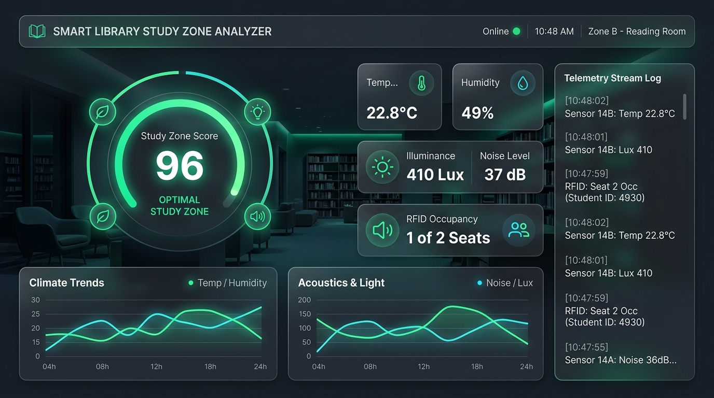

# Smart Library Study Zone Analyzer

An IoT-based system for monitoring and analyzing environmental conditions in library study zones. The system uses ESP32 and sensors to collect real-time data, analyze study-zone conditions, and provide useful insights through a dashboard.

## 📌 Project Overview

Libraries often have multiple study zones with different environmental conditions such as temperature, humidity, lighting, and noise levels. These factors can influence the comfort and suitability of a study environment.

The **Smart Library Study Zone Analyzer** aims to monitor these conditions using IoT technology and convert the collected data into meaningful information about the quality of different study zones.

## 🎯 Objective

The main objective of this project is to:

* Monitor environmental conditions in library study zones.
* Collect real-time sensor data using ESP32.
* Store and process the collected data.
* Analyze environmental conditions.
* Generate a study-environment score for different zones.
* Provide a dashboard for monitoring and visualization.
* Help identify suitable study environments based on collected data.

## 🚀 Planned Features

* Real-time environmental monitoring
* ESP32-based IoT system
* Temperature monitoring
* Humidity monitoring
* Light-level monitoring
* Noise-level monitoring
* Sensor data collection
* Data storage
* Environmental data analysis
* Study Environment Score
* Study-zone comparison
* Historical data visualization
* Web-based dashboard
* Future intelligent recommendations

## 🏗️ System Architecture

The planned system will follow this general workflow:

```text
┌───────────────────────┐
│   Sensors + ESP32     │
│                       │
│ Temperature           │
│ Humidity              │
│ Light                  │
│ Noise                  │
└───────────┬───────────┘
            │
            ▼
┌───────────────────────┐
│    Data Collection    │
└───────────┬───────────┘
            │
            ▼
┌───────────────────────┐
│      Backend / API    │
└───────────┬───────────┘
            │
            ▼
┌───────────────────────┐
│       Database        │
└───────────┬───────────┘
            │
            ▼
┌───────────────────────┐
│      Analytics        │
│                       │
│ Environment Analysis  │
│ Study Zone Score      │
└───────────┬───────────┘
            │
            ▼
┌───────────────────────┐
│     Web Dashboard     │
└───────────────────────┘
```

> The architecture may change during development based on hardware, software, and testing requirements.

## 🛠️ Technologies

### Hardware

* ESP32
* Environmental sensors
* Light sensor
* Noise sensor
* Other sensors as required

### Software

* C/C++ for ESP32 firmware
* Python for backend/analytics
* Database
* HTML/CSS/JavaScript or selected dashboard framework
* Git
* GitHub

## 📂 Repository Structure

```text
smart-library-study-zone-analyzer/
│
├── README.md
│
├── hardware/
│   ├── circuit-diagram/
│   ├── esp32/
│   └── components.md
│
├── backend/
│   ├── api/
│   ├── database/
│   └── requirements.txt
│
├── dashboard/
│   ├── frontend/
│   └── screenshots/
│
├── analytics/
│   └── study_score.py
│
├── docs/
│   ├── project-proposal.md
│   ├── architecture.md
│   └── future-scope.md
│
└── images/
    ├── prototype/
    ├── circuit/
    └── dashboard/
```

The repository structure may evolve as the project develops.

## 📊 Study Environment Analysis

The system will collect environmental parameters from different study zones and use the data to evaluate their overall study conditions.

A potential scoring model may consider:

```text
Temperature
     +
Humidity
     +
Lighting
     +
Noise Level
     ↓
Environmental Analysis
     ↓
Study Environment Score
```

The exact scoring methodology will be finalized after sensor testing and analysis.

## 📷 Live Dashboard Preview



## 🚀 Quickstart Guide

### 1. Start Backend & Dashboard Server
```bash
# Install dependencies
pip install -r backend/requirements.txt

# Start FastAPI server (serves API on :8000 and Web Dashboard on /)
python -m uvicorn backend.api.main:app --host 0.0.0.0 --port 8000
```
- Open `http://localhost:8000/` or `http://<your-pc-ip>:8000/` in any browser.
- Open Swagger API interactive docs at `http://localhost:8000/docs`.

### 2. Flash ESP32 Firmware
1. Open [`hardware/esp32/main_esp32/main_esp32.ino`](file:///d:/study/5th%20sem/eiot/eiot%20prj/smart-library-study-zone-analyzer/hardware/esp32/main_esp32/main_esp32.ino) in Arduino IDE.
2. Confirm your Wi-Fi SSID and password in lines 13-14.
3. Ensure `serverUrl` points to your PC's Wi-Fi IP address on port 8000 (e.g. `http://10.119.111.165:8000/readings`).
4. Select board **ESP32 Dev Module** and upload.

### 3. Test Without Hardware (Interactive Simulator)
Open the dashboard at `http://localhost:8000/`, click the **Simulator** button on the top right, adjust sensor sliders (Temperature, Humidity, Light, Noise, Occupancy), and click **Transmit Packet** or toggle **Start Auto Stream**!

## 👥 Team

| Member | Responsibility | Status |
| :--- | :--- | :--- |
| **Vid Bhardwaj** | IoT, ESP32 Firmware & Hardware Sensors | Complete (v2.0 Self-Healing) |
| **Skand Jha** | Backend API & Self-Balancing Database | Complete (FastAPI + SQLite Failover) |
| **Shubham Singh** | Dashboard Frontend & Study Score Analytics | Complete (Interactive Glass UI + Scoring Engine) |

## 📈 Project Status

✅ **Functional Working Release (v2.0 Complete)**
- Real-time ESP32 edge telemetry ingestion
- Multi-factor Study Environment Score algorithm
- Dual-mode resilient database architecture
- Live glassmorphism web dashboard with Canvas trend charts & hardware simulator


## 🔮 Future Scope

Potential future enhancements include:

* AI/ML-based study environment prediction
* Personalized study-zone recommendations
* Occupancy monitoring
* Real-time zone availability
* Mobile application
* Automated alerts
* Advanced environmental analytics
* Multiple-library deployment
* Cloud-based data processing
* Long-term environmental trend analysis

## 📌 Disclaimer

This project is developed for educational, experimental, and academic purposes. Sensor selection, scoring methodology, and system architecture may change during development based on testing and project requirements.

## 📄 License

No open-source license has been assigned at this stage.

The licensing strategy may be decided when the project is ready for public release.
