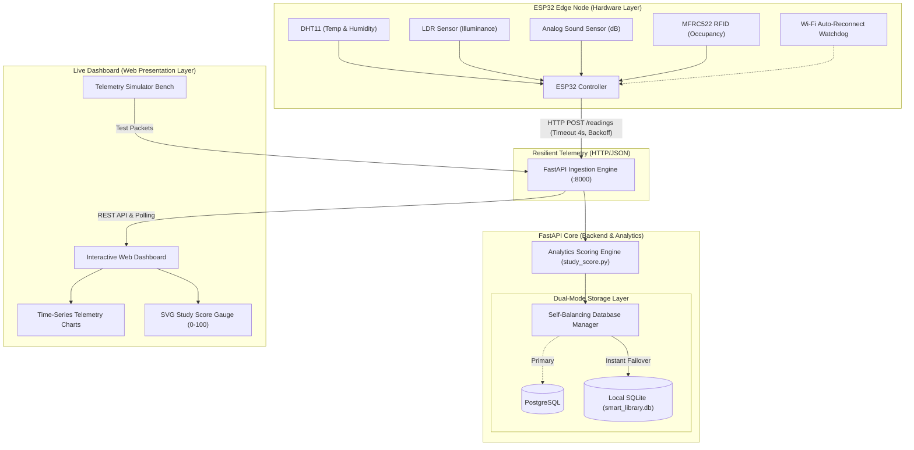

# System Architecture: Smart Library Study Zone Analyzer

The **Smart Library Study Zone Analyzer** is an end-to-end Embedded Internet of Things (EIOT) system designed to measure, evaluate, and optimize environmental conditions in library study zones.

---

## 1. High-Level Architecture Diagram

---

## 2. Hardware Edge Node (ESP32)

| Component | Pin | Function | Fail-Safe / Resilience Feature |
| :--- | :--- | :--- | :--- |
| **ESP32 DevKit** | — | Core MCU running FreeRTOS | Non-blocking `millis()` loop; task yielding |
| **DHT11** | GPIO 4 | Ambient temperature & relative humidity | NaN filtering with fallback cache |
| **Analog Sound Sensor** | GPIO 34 (ADC1) | Ambient acoustic noise levels | Constrained 30–100 dB mapping |
| **LDR Light Sensor** | GPIO 35 (ADC1) | Reading plane illuminance (Lux) | Inverted/calibrated 50–850 Lux curve |
| **MFRC522 RFID** | SPI (5, 18, 19, 23, 22) | Room check-in/check-out occupancy tracking | Zero-latency instant scan; capacity limit |
| **Status LED** | GPIO 2 | Visual transmission & RFID badge pulse | Flash on card tap; solid when Wi-Fi active |

---

## 3. Study Environment Scoring Model

The overall score $S \in [0, 100]$ is computed using weighted multi-factor comfort indices:

$$S = 0.35 \times S_{\text{acoustic}} + 0.25 \times S_{\text{thermal}} + 0.25 \times S_{\text{visual}} + 0.15 \times S_{\text{occupancy}}$$

- **Acoustic Comfort ($35\%$)**: Strict penalty for ambient noise exceeding library threshold ($< 42 \text{ dB}$ is $100\%$, $> 70 \text{ dB}$ drops below $40\%$).
- **Thermal Comfort ($25\%$)**: Optimized around ASHRAE 55 indoor comfort standards ($21^\circ\text{C} - 24.5^\circ\text{C}$, $40\% - 60\% \text{ RH}$).
- **Visual Comfort ($25\%$)**: Based on CIBSE/IESNA reading illuminance standards ($300 - 500 \text{ Lux}$).
- **Occupancy Comfort ($15\%$)**: Proportion of occupied seats relative to room capacity ($< 70\%$ is comfortable; $100\%$ triggers capacity alerts).

---

## 4. Self-Balancing Architecture (Antigravity Pattern)

- **Graceful DB Failover**: If PostgreSQL server is not found on localhost:5432 within a 1-second timeout, the system routes directly to an embedded SQLite database (`backend/smart_library.db`), eliminating HTTP timeouts.
- **Adaptive Network Backoff**: If connectivity is disrupted, the ESP32 doubles its interval from 5s up to 20s to avoid flooding, then auto-resets upon success.
- **Independent Web Simulator**: Built directly into the dashboard so developers can inject sensor packets to test analytics even when the physical ESP32 is offline.
